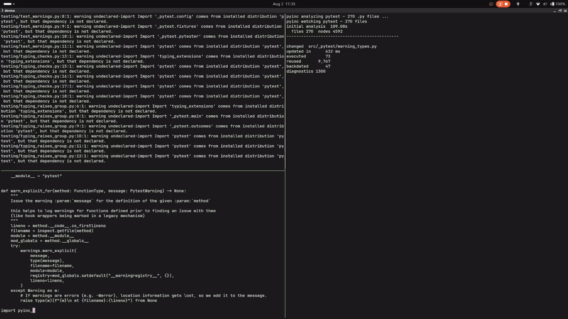

# pyinc

[](https://github.com/Brumbelow/pyinc/actions/workflows/ci.yml)
[](https://pypi.org/project/pyinc/)
[](https://pypi.org/project/pyinc/)
[](https://pypi.org/project/pyinc/)
[](https://docs.astral.sh/ruff/)

*Salsa-style red-green queries, hardened for Python's mutable runtime.*

`pyinc` is a correctness-first incremental query engine for Python. Declare
keyed inputs and pure queries, and it records the dependency graph while your
code runs. On the next request it reuses unaffected work, recomputes affected
queries, and backdates semantically equal results so downstream work stays
valid. It is pure Python and stdlib-only, with zero runtime dependencies.
It is built to replace a hand-rolled caching layer and its cache-invalidation
bugs, such as the editor still underlining an error you fixed a minute ago.

Python 3.11 to 3.14 and the free-threaded 3.14t build are supported and tested
on Linux, macOS, and Windows. Python 3.15 and later are not supported, because
query identity reads bytecode and module metadata, and both change with every
CPython minor release.

```console
python -m pip install pyinc
```

## Status

pyinc is feature-complete. No new features are planned. Bug fixes and
soundness fixes are welcome as pull requests.
[CONTRIBUTING.md](https://github.com/Brumbelow/pyinc/blob/main/CONTRIBUTING.md)
has the setup and the checks. No response time is promised. The supported
Python versions are 3.11 to 3.14, plus the free-threaded 3.14t build.

Semantic versioning covers only what `pyinc` and `pyinc.integrations` export.
`pyinc_tools` and `pyinc_codegen` are feature-frozen: their behavior changes
only to fix a defect.

## Quick start

```python docs-check
from __future__ import annotations

from pyinc import Database, Input, query

NAMES = Input[tuple[str, ...]]("example.names")


@query
def normalized_names(db: Database) -> tuple[str, ...]:
    return tuple(sorted({name.strip() for name in NAMES.read(db)}))


db = Database(mode="strict")
db.set(NAMES, (" Grace ", "Ada", "Ada"))
assert db.get(normalized_names) == ("Ada", "Grace")

db.set(NAMES, ("Grace", "Ada"))
assert db.get(normalized_names) == ("Ada", "Grace")
assert db.inspect(normalized_names).last_decision == "backdated"
```

The first request computes the result. The second input is different, so the
query runs again, but its result is semantically equal. `pyinc` backdates that
node, so everything downstream stays valid.

## See it on a real workspace



`pyinc-tools` was pointed at a pinned checkout of pytest, with nothing in it
adapted for `pyinc`, and watched while single files were edited. The recording
was made with a development build of pyinc 3.1.
[The demo page](https://github.com/Brumbelow/pyinc/blob/main/docs/demo.md) has
the clips and their provenance. For numbers from your own machine, run
`python -m bench.overhead` from the repository root. It prints cost ratios
measured in one run. The
[benchmark README](https://github.com/Brumbelow/pyinc/blob/main/bench/README.md)
describes the harness.

## Documentation

- [Getting started](https://github.com/Brumbelow/pyinc/blob/main/docs/getting-started.md): build a small graph, add a tracked file, choose a mode, inspect work, and write a first action.
- [Examples](https://github.com/Brumbelow/pyinc/tree/main/examples): small runnable scripts, including the `calc` worked example.
- [FAQ](https://github.com/Brumbelow/pyinc/blob/main/docs/faq.md): how this relates to Salsa, why not `lru_cache`, threading, scope, and when not to use it.
- [Kernel contract](https://github.com/Brumbelow/pyinc/blob/main/docs/kernel-contract.md): the from-scratch consistency guarantee, its three conditions, modes, checkpoints, and limitations. The [action contract](https://github.com/Brumbelow/pyinc/blob/main/docs/action-contract.md) covers declared-output reconciliation.
- [Integration contract](https://github.com/Brumbelow/pyinc/blob/main/docs/integration-contract.md): stable entrypoints, result types, supported shapes, and limits.
- [`pyinc-tools` guide](https://github.com/Brumbelow/pyinc/blob/main/docs/pyinc-tools-guide.md) and [LSP reference](https://github.com/Brumbelow/pyinc/blob/main/docs/lsp-reference.md): CLI, editor setup, overlays, protocol methods, and user-visible limitations.
- [Documentation index](https://github.com/Brumbelow/pyinc/blob/main/docs/README.md): every document, the package map, and the authoring and codegen guides.
- [Releases and verification](https://github.com/Brumbelow/pyinc/blob/main/docs/releases.md): what the release workflow checks, trusted publishing, and checking a download.

One distribution ships three top-level typed packages: `pyinc`, `pyinc_tools`,
and `pyinc_codegen`. The stable integration surface, `pyinc.integrations`, is a
subpackage of `pyinc`.

- `pyinc`: the stable query kernel, resources, snapshots, artifact stores, and declared-output actions
- `pyinc.integrations`: stable analysis results and entrypoints for Python source, configuration, dependencies, symbols, and notebooks
- `pyinc_tools` (feature-frozen): `pyinc-tools analyze`, a polling watcher, `WorkspaceSession`, and a stdio LSP server
- `pyinc_codegen` (feature-frozen): JSON Schema to typed Python generation

## Development

```console
git clone https://github.com/Brumbelow/pyinc.git
cd pyinc
python3 -m venv .venv
. .venv/bin/activate
python3 -m pip install -e '.[dev]' -c constraints.txt
python3 scripts/check_docs.py
pytest -n auto -m 'not process' --ignore tests/test_properties.py --tb=short
python3 -m mypy src tests bench scripts examples
python3 -m mypy --platform win32 src tests bench scripts examples
python3 -m ruff check src tests bench scripts examples
```
