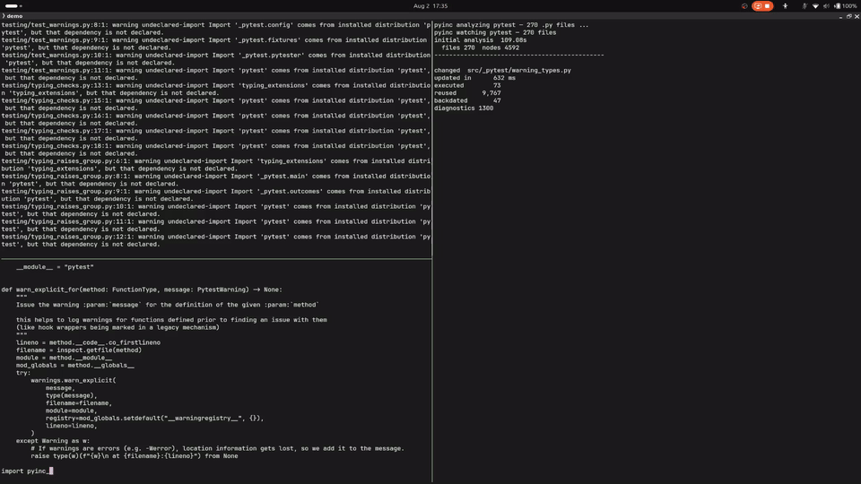
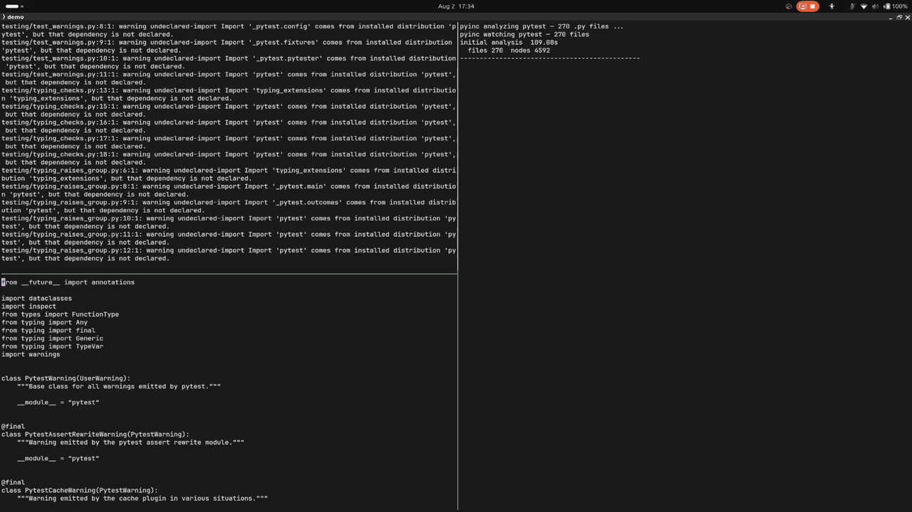

# Demo: pyinc on a Real Workspace

This page shows `pyinc-tools` running against a workspace written without
`pyinc` in mind: a checkout of pytest pinned at
`56b196e921acec0259d84622a570fde6032e15b5`. The checkout is used as is, with
no added configuration.



The watcher analyzes the tree once, then re-analyzes when edited files settle.
The stats pane shows both halves of that split. It was written for the
recording. `pyinc-tools` does not print it. The diagnostics are
`undeclared-import` findings: imports of installed distributions that pytest's
own dependency metadata leaves undeclared. Whether each finding is a pytest
defect is a separate question.



Two edits back to back: a comment the engine absorbs as backdates, then an
unresolvable import that surfaces as a new diagnostic.

## Provenance

The clips are a single live recording made as a demonstration: one take, one
run, no repetitions. The recording was made with a development build of
pyinc 3.1. The figures on screen come from that take, on the machine described
below. Treat them only as an illustration of the cold/warm split.

- Workspace: pytest pinned at `56b196e921acec0259d84622a570fde6032e15b5`,
  270 `.py` files, no configuration added.
- Command: `pyinc-tools analyze . --watch --format text`, with edits made to
  `src/_pytest/warning_types.py` in a separate pane.
- "Cold" means a freshly started watcher process analyzing the tree for the
  first time, with no prior in-memory state and no durable checkpoint.
- Environment: the 3.1 release lineage of `pyinc`, CPython 3.14.4 on Linux,
  Intel Core 7 240H (16 CPUs), local ext4 disk, machine otherwise idle.

For numbers from your own machine, run `python -m bench.overhead` from the
repository root. It prints cost ratios measured in one run. For controlled,
repeated measurements, use the benchmark harness.
`python -m bench.run --output bench/results --repetitions 5` records the exact
commit, Python build, OS, CPU, and repetition metadata alongside its results
(see [bench/README.md](../bench/README.md)).

Point it at a tree of your own:

```console
pyinc-tools analyze /path/to/workspace --watch --format text
```

The [tooling guide](pyinc-tools-guide.md) covers installation, overlays, output
shapes, and exit statuses. The [integration contract](integration-contract.md)
states the scope of this analysis. It reads code without executing it, its
resolution is static and conservative, and it is not a type checker.
